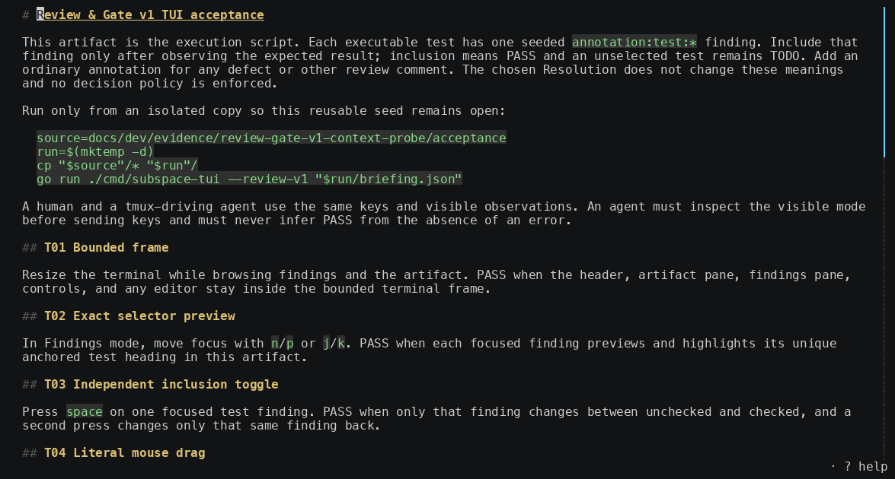
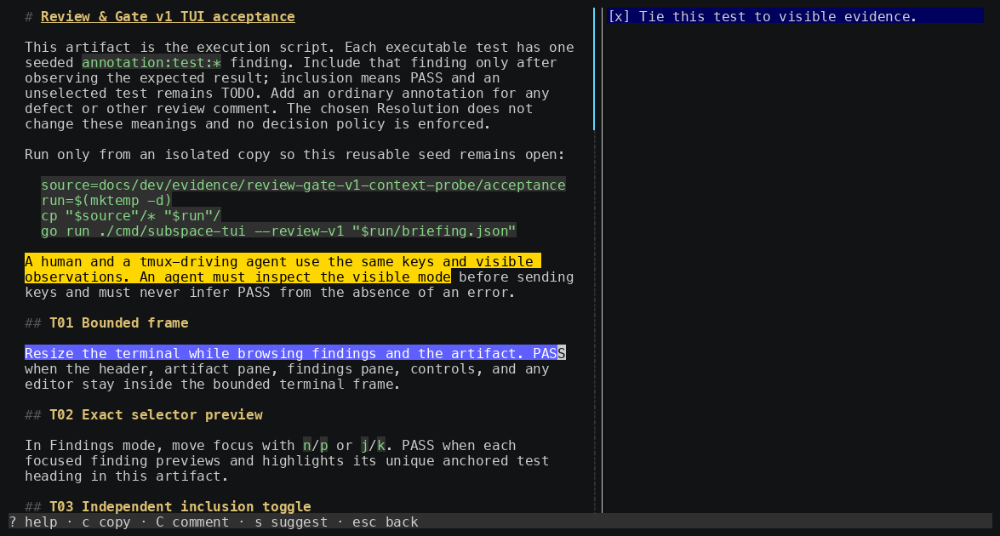
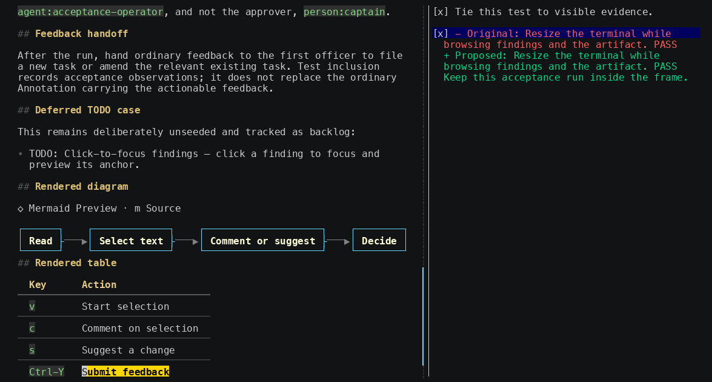

# Subspace

Review one Markdown file in your terminal.

Subspace includes a companion agent skill that launches its focused reader in
Zellij, tmux, CMUX, Herdr, Ghostty, or Apple Terminal. It sends comments and
suggested edits directly back to the invoking agent, attached to exact text.



## Install and try it

```sh
brew install spacedock-dev/tap/subspace-beta
```

### Linux, or macOS without Homebrew

Install the prebuilt binary directly. The installer resolves the latest
release through the canonical latest-release URL
`http://spacedock.md/latest-release/subspace`, verifies the release's
checksum before anything is placed, and installs `subspace-tui` into
`~/.local/bin`:

```sh
curl -fsSL https://raw.githubusercontent.com/spacedock-dev/subspace/main/install.sh | sh
```

Add `~/.local/bin` to your `PATH` if it is not already there.

```sh
sr path/to/file.md
```

### Install the companion agent skill

In Claude Code, add the marketplace and install the plugin:

```sh
claude plugin marketplace add spacedock-dev/marketplace
claude plugin install subspace@subspace-beta
```

In Codex, add the marketplace and the plugin:

```sh
codex plugin marketplace add spacedock-dev/subspace-beta --json
codex plugin add subspace@subspace-beta --json
```

From an agent session with the companion skill installed, invoke:

```text
/r path/to/file.md
```

In Codex, invoke:

```text
$r path/to/file.md
```

Add `--allow-question` to let the reviewer ask your agent questions about the
file while the review stays open, and read the answer in the same surface:

```text
/r --allow-question path/to/file.md
```

```text
$r --allow-question path/to/file.md
```

## Agent integration

Ask your agent to open the review with the Subspace skill. This example uses
tmux and lets the reviewer ask questions during the review:

```text
$r --allow-question path/to/file.md tmux
```

Press <kbd>Q</kbd> to ask about the file. The agent keeps a poller active while
the review is open. It answers from the same file that you can see in Subspace.
You can continue the review while the agent prepares the answer.

Review starts in a pager-first Browse surface. Comment on the focused block
with <kbd>c</kbd>, or use <kbd>s</kbd> to start an explicit Range Target for a
replacement. In Range Target, <kbd>y</kbd> copies the range, <kbd>c</kbd>
comments on it, and <kbd>s</kbd> suggests its replacement. Press <kbd>?</kbd> on
a non-input review surface for the complete map below.

<!-- subspace-key-map:start -->
### Global

| Surface | Control | Action |
| --- | --- | --- |
| Review | `q` | done |
| Decision review | `Tab` | choose decision |
| Review | `?` | help |
| Review | `Ctrl-O` | leave open |
| Reader | `Y` | toggle side pane |
| Reader | `Ctrl-Y` | read Findings |

### Browse

| Surface | Control | Action |
| --- | --- | --- |
| Browse | `j/k/↑/↓` | move block |
| Browse | `Space/f/PgDn/Ctrl-F` | page forward |
| Browse | `b/PgUp` | page backward |
| Browse | `g/Home · G/End` | document bounds |
| Context | `j/k/↑/↓` | move |
| Context | `PgUp/PgDn` | page |
| Context | `g/G` | document bounds |
| Context | `Home/End` | line bounds |
| Browse | `c` | comment block |
| Browse | `s` | select range |
| Browse | `→/Esc` | focus Findings |

### Range

| Surface | Control | Action |
| --- | --- | --- |
| Range | `↑/↓/←/→/hjkl` | move target |
| Range | `Space/PgUp/PgDn` | page |
| Range | `g/G` | document bounds |
| Range | `Home/End` | line bounds |
| Range | `y` | copy range |
| Range | `c` | comment target |
| Range | `s` | replace range |
| Pending suggestion | `Enter` | continue suggestion |
| Range | `Esc` | clear target |

### Findings

| Surface | Control | Action |
| --- | --- | --- |
| Findings | `j/k/n/p/↑/↓` | focus row |
| Findings | `x` | include annotation |
| Findings | `e` | edit draft |
| Focused answer | `Enter` | open answer |
| Open answer | `Space/PgUp/PgDn` | page answer |

### Finish

| Surface | Control | Action |
| --- | --- | --- |
| Finish | `type/Ctrl-E` | overall input |
| Finish input | `Tab` | insert tab |
| Finish | `Enter` | send |
| Finish | `Esc` | back |

### Tools

| Surface | Control | Action |
| --- | --- | --- |
| Input | `Enter` | save |
| Input | `Ctrl-J` | newline |
| Input | `Alt-Enter` | distinct newline |
| Input | `Esc` | back |
| Browse/Range/Context | `/ · n/N` | find · next/previous |
| Reader | `A` | choose source |
| Artifact | `[/]` | previous/next |
| Artifact/Range | `F` | frontmatter |
| Folded frontmatter | `Enter on …` | expand/collapse |
| Mermaid | `m` | render/source |
| Reader | `:/#` | line/gutters |
| Question | `Q/R/T` | ask/refresh/auto-refresh |
| One file | `D` | toggle focus |
| Find/Context | `Ctrl-C` | cancel |
| Source picker | `j/k` | move |
| Source picker | `Enter` | open |
| Source picker | `Esc` | cancel |

<!-- subspace-key-map:end -->



Subspace renders Mermaid diagrams and tables natively in the terminal, not as
plain fenced code.



## License

The Subspace skills are released under Apache 2.0. The `subspace-tui` tool
itself is not currently open source. The permissions and attributions for
external code linked into the tool are published in
[`THIRD_PARTY_NOTICES.txt`](THIRD_PARTY_NOTICES.txt).
